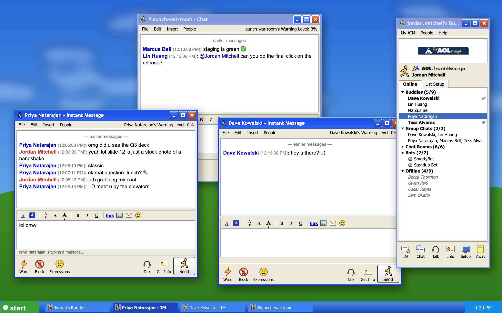

# AIM for Slack

AOL Instant Messenger 5.5, the 2004 Windows XP version, as a front end for Slack.



You get a Buddy List window and one Instant Message window per conversation, and new IMs pop open the way they used to. It uses the original door-open and door-slam sounds and the IM chime. Your regular Slack app keeps working as usual alongside it.

## Build it with your coding agent

Point Claude Code, Codex, Cursor, or any coding agent at this repo and say:

> Build and install AIM for Slack from this repo. Follow AGENTS.md.

[AGENTS.md](AGENTS.md) walks the agent through the requirements, a self-test (`npm run check`), the build, and the first launch. Every step has a pass/fail check.

## How it works

AIM for Slack doesn't need a Slack API token or a custom Slack app, so there's nothing for a workspace admin to approve. Instead, it rides on the Slack desktop app you're already signed in to:

- Slack runs with Chromium's remote-debugging port turned on (`--remote-debugging-port=9333`). The port only listens on `127.0.0.1`.
- AIM connects to that port. It calls Slack's Web API **from inside Slack's own page**, using Slack's existing session, so the token never leaves Slack.
- Live messages, typing, and presence come from watching the websocket traffic Slack already receives.

The first time you sign on, AIM asks before restarting Slack with the bridge turned on. Slack reopens still signed in.

## Try it without Slack

`npm run demo` runs AIM on a fake workspace, so nothing touches your real Slack.

## Requirements

- macOS
- The Slack desktop app (not the browser version), signed in to any workspace. Regular workspaces and Enterprise Grid should both work. With several workspaces, AIM uses whichever one is open in Slack.
- Node.js 20 or newer

## Install

```sh
git clone https://github.com/nigelcarreiro-blip/aim-for-slack.git
cd aim-for-slack
npm ci
npm run check             # self-test on a fake workspace; must end with "ok":true
npm run install-app       # build AIM.app and copy it into /Applications
open /Applications/AIM.app
```

You can also run `npm start` to run it from source.

`npm run build` builds `dist/AIM.app` without installing it. The app is ad-hoc signed, so the first time you open it macOS may ask you to confirm in System Settings > Privacy & Security.

## What's in it

- **Sign On window**: your Slack handle is your screen name. Tick Auto-login to skip it next time.
- **Buddy List**: groups that fold open and closed.
  - Buddies: people you have DMs open with, the ones online right now.
  - Group Chats: your group DMs.
  - Chat Rooms: your channels.
  - Bots
  - Offline
  
  Double-click a buddy to IM them. Click **IM** with nobody selected to message anyone in the workspace.
- **Instant Message windows**:
  - screen names in red (you) and blue (them), with timestamps
  - the File / Edit / Insert / People menus
  - B / I / U formatting, which becomes Slack bold, italic, and strikethrough
  - smileys, and a running-man Send button
  - Warn: a joke that only raises a local "Warning Level" and never touches Slack
- **Pop-ups**: a new DM or group DM opens its window without stealing focus and plays the incoming-message chime. Channels stay quiet unless someone @mentions you.
- **Away messages**: setting one sets your Slack status and presence.
- **Preferences** (My AIM > Preferences, or Setup):
  - pop-up behavior for IMs, group chats, and @mentions
  - whether @here and @channel count as mentions
  - macOS notification banners
  - sounds

AIM never changes your Slack notification settings.

Threads, huddles, canvases, and file uploads stay in Slack. AIM shows "(2 replies in Slack)" links, and Talk / Get Info jump to that conversation in Slack.

## Caveats

- **Unofficial.** This isn't made by or affiliated with Slack or AOL. It drives your own logged-in Slack client the way a browser extension might. Check your workplace's IT policy before using it on a work account.
- **The debug port is local, but it is powerful.** While Slack runs with it, any program on your Mac can use it to read your Slack session. Quit Slack and reopen it normally to turn the port off.
- **It can break.** It depends on Slack's internal web client, which Slack can change at any time.

## Credits

The sounds and artwork in `assets/sounds` and `assets/img` come from AOL Instant Messenger 5.5.3595 (2004). See [NOTICE.md](NOTICE.md). Everything else is MIT licensed; see [LICENSE](LICENSE).
